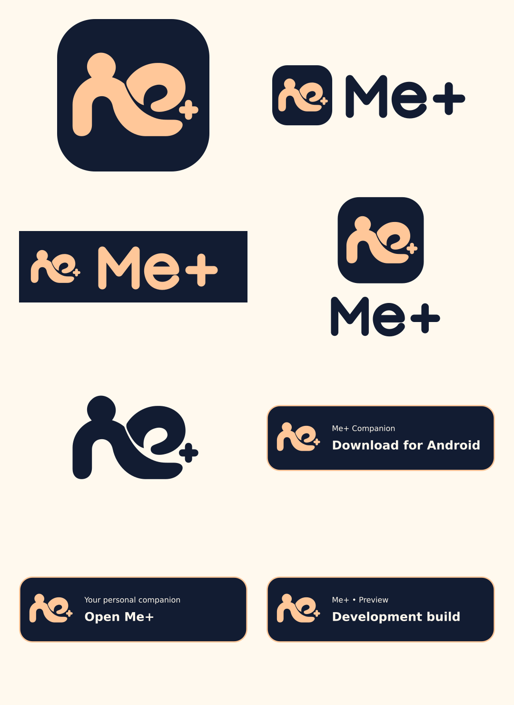

# Me+ Companion

The selected Me+ identity: an apricot companion/person flowing into an open **e**, with a small plus, on navy. These are editable flat vector redraws of the selected concept, retaining its silhouette and proportions while removing the presentation texture. The custom rounded wordmark is drawn as paths and requires no font.



## Asset inventory

| Folder | Assets | Use |
| --- | --- | --- |
| `masters/` | Rounded and square SVG icon | Source for app tiles and exports |
| `marks/` | Navy, apricot, ivory, black and white transparent SVG; four 1024px PNG variants | Avatars, overlays and monochrome printing |
| `logos/` | Horizontal and stacked SVG in light, dark, transparent navy, white and black; horizontal PNG | Navigation, splash, documentation and marketing |
| `android/` | 1024px square launcher; transparent adaptive foreground, solid background and white monochrome, SVG/PNG | Inputs for Expo/native launcher integration |
| `web/` | 16, 32, 48, 192 and 512px PNG; 180px Apple touch icon; maskable SVG/512px PNG; multi-size ICO | Favicons, home-screen icons and web manifests |
| `badges/` | Android download, Open Me+, development build and Powered by Me+; SVG and 2× PNG | Download links and brand attribution |
| `tokens.json` | Palette | Design and implementation reference |
| `SHA256SUMS` | Per-file checksums | Integrity and export inventory |

## Palette and usage

| Token | Hex | Role |
| --- | --- | --- |
| Navy | `#121C32` | Primary background and dark ink |
| Apricot | `#FFC799` | Symbol, warm accent and reverse lettering |
| Ivory | `#FFF9EE` | Light background and reverse text |

Use the rounded tile for avatars and general branding. Use the **square** tile for OS-managed app icons so the platform supplies the mask. Use `icon-maskable-512.png` for maskable web contexts; the regular icon is not the maskable version. Android foreground and monochrome art have inset padding for launcher masks; use the separate solid navy background. Validate on real devices before shipping.

Keep at least the height of the small plus clear around a mark. Keep marks proportional; do not rotate, stretch, add shadows or recolor individual pieces. Use black/white versions when color is unavailable. Recommended minimums: icon 32px, horizontal logo 160px wide, download badge 240px wide. The 16px favicon is supplied for browser fallback and loses fine detail. Use high-contrast light/dark versions on a plain background.

Badges describe actions, not distribution status. Link Android to the verified `/download` page and web to the configured Me+ origin. The development badge must remain visible for preview builds. No Google Play or App Store availability is implied. Supply accessible link text (`Download Me+ for Android`, `Open Me+`) or an equivalent image alt; use empty alt for purely decorative marks beside a visible name.

## Integration boundary

This kit adds resources only. It does not replace current runtime UI assets, update Expo configuration, change APK versions, rebuild Android or publish a store listing. Copy the chosen resources into the platform's asset directory, wire metadata/configuration, and validate in a separate integration change. `web/manifest.example.json` is an icon-fragment example with placeholder `/brand/` asset URLs, not an activated installable PWA manifest.

## Regeneration

From the repository root, with `sharp` 0.35.5 available (the renderer used for these exports):

```sh
node brand/companion/generate.cjs
cd brand/companion
sha256sum -c SHA256SUMS
```

If `sharp` is not directly resolvable in your workspace, install it in an isolated tooling directory and expose that directory's `node_modules` with `NODE_PATH`; no app dependency changes are required. Badge SVG text uses DejaVu Sans with a sans-serif fallback; PNG exports were rendered using DejaVu Sans. Different font/rendering versions can change PNG hashes. Primary marks and logos contain paths only. Edit SVG geometry in `generate.cjs` so regeneration preserves changes. Checksums include this guide and the generator; regenerate after editing either.

Provenance: user-selected Companion concept supplied on 2026-10-17. This repository kit is a flat SVG redraw, not the textured presentation image. Name and concept approval does not establish trademark clearance.
