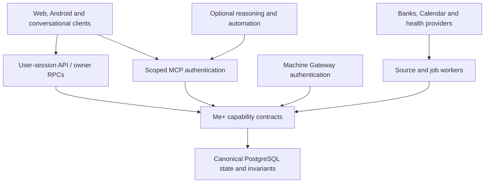

# Me+ 2.0 architecture

**Revision:** 17 October 2026. Current-source facts and proposed improvements are distinguished below. The target design is described in [ADR 0002](adr/0002-meplus2-modular-core-and-adapters.md), currently proposed. This documentation revision changes no runtime.

## System shape

Me+ is one personal-intelligence product with first-class web and native clients, conversational access and canonical Supabase state. Preserve its small modular core and make provider/runtime adapters replaceable.

The current stack is **Next.js/React web, Expo/React Native Android, TypeScript shared packages, Supabase PostgreSQL/Auth/Edge Functions, Node Netlify functions, pnpm and GitHub Actions**. Concrete versions are pinned in the manifests and lockfiles. Framework selection is complete; production and client acceptance remain separate work.

```text
apps/
  web/        # dashboard, analysis, configuration, administration
  mobile/     # daily interaction, notifications, capture, device integrations
packages/
  domain/     # business rules and domain services
  contracts/  # shared types, schemas and service contracts
  ui/         # reusable presentation primitives where genuinely portable
  reasoning/  # provider-neutral reasoning interfaces, policies and orchestration
supabase/
  migrations/ # canonical schema evolution
  functions/  # server-side functions only where justified
tests/        # cross-cutting integration/e2e fixtures and suites
```

## Capability and trust boundaries



This is a logical boundary diagram, not a claim that every caller currently uses one implementation. User APIs, machine Gateway and scoped MCP have distinct authentication mechanisms. They converge on the same owner/operation/domain policy and canonical operations; a generic privileged endpoint is not a prerequisite.

Prepared Letta/n8n clients use scoped MCP grants. The existing machine Gateway key remains a trusted server credential; do not hand it to optional runtimes to bypass those grants. A later bridge must preserve scoped authorization for every translated operation.

## Current ownership and proposed refinements

### `apps/web`
Owns routing, rendering, accessibility, SSR session handling and thin user-facing server adapters. Existing finance/health server modules live here today; reusable finance/provider application code is a planned extraction. Netlify workers currently import those web modules, so the desired presentation boundary is not yet fully enforced.

### `apps/mobile`
Owns native navigation, permissions, Health Connect collection, local lifecycle, notification presentation and bounded offline behavior. Native readings cross typed ingestion contracts before entering canonical state. The current app is concentrated on health collection/diagnostics; complete daily-product UX remains planned. Foreground polling and closed-app background sync are different capabilities.

### `packages/domain`
Owns pure platform-neutral transformations and reusable domain services. It must not import browser/native/UI/deployment APIs. PostgreSQL remains the authoritative implementation for transactional ownership, recurrence, lifecycle, request receipts and invariants; do not duplicate those rules in clients under the label of code sharing.

### `packages/contracts`
Owns public DTOs, validated event shapes, supported operations, lifecycle/error semantics and compatibility versions. Current starter types cover only a subset of backend capabilities. Planned work adds a capability catalog, reproducible database type generation and runtime schemas for untrusted boundaries. UI categories are presentation groupings; database domain codes require explicit mapping.

### `packages/ui`
Contains genuinely shared tokens and primitives. Share behavior and vocabulary while keeping web/native rendering accessible and idiomatic. It is currently a small token package, not a complete cross-platform design system.

### `packages/reasoning`
Defines provider-neutral reasoning contracts and policy composition. Actual worker/model routing is also implemented in Edge/SQL code; the package is not proof of a complete production orchestration layer. Plan bounded context, runtime output validation, usage budgets and evaluation before moving behavior. Models and procedural agent memory never own current personal facts.

### `supabase`
Owns schema evolution, owner/RLS policy, transactional write boundaries, deterministic lifecycle, receipts, audit and source/job state. Canonical personal data stays here. Historical migrations and deployed functions need exact provenance reconciliation before new clean-environment replay or redeployment. Shared dev/production data is a known deployment boundary; code branches do not isolate it.

### Server-only provider/application module — proposed

Extract reusable Node finance ingestion and provider transport from the web tree after contract tests. Choose a package/module name at implementation time; do not create it merely to satisfy a folder diagram. Keep secrets, admin clients and provider signing server-only, and verify their absence from browser/native bundles.

Node/Netlify and Deno/Edge entrypoints remain separate adapters. Reuse portable contracts/helpers where compatible; do not force Node-specific crypto or framework helpers into Deno. A module extraction must preserve pinned runtime behavior and deployment artifacts.

### Integrations and optional runtimes

Native high-trust workers ingest banking, Calendar and health through validated, auditable operations. Optional n8n workflows call scoped capabilities; they do not bypass canonical writes. Letta receives purpose-specific current context and may retain approved procedural knowledge. Langfuse receives an allowed metadata subset only after privacy/retention gates. None is required for routine scheduling or deterministic correctness.

The ChatGPT development connectors are host tools. They do not automatically provide application runtime credentials, provider consent or a deployed Me+ integration. This includes Slack and the Supabase development connector.

## Facts, derived state and actions

1. A provider or user creates a validated fact with owner, source, observed/recorded time, quality and raw provenance where justified.
2. Deterministic policy resolves freshness, corrections, recurrence, capacity and current state. Derived snapshots identify their input/version/as-of boundary.
3. A purpose-specific read supplies only necessary context to a client or approved reasoning route.
4. A typed recommendation remains separate from a task, factual outcome, helpfulness rating and follow-through. Silence is not a negative rating or proof of completion.
5. A permitted canonical mutation carries a stable request ID and audit provenance, then returns committed state or a receipt. Clients confirm through readback.
6. A notification/external adapter acts only on an explicitly authorized event; its delivery state never becomes canonical task truth.

## Shared lifecycle contracts to finish

| Boundary | Required contract |
| --- | --- |
| User session | Verified owner, SSR refresh, cache isolation, safe return URL, logout/recovery, native credential storage |
| Read surface | Bounded fields/limit, schema version, state timestamp, source freshness and explicit unknown/error state |
| Canonical write | Owner-scoped typed operation, request ID, expected version where needed, atomic audit/receipt and retry semantics |
| Job | At-least-once dispatch, connection-scoped lease/generation, bounded attempts, atomic page/checkpoint, dead-letter visibility |
| Source | Configured/deployed/authorized/first-sync/recurring state distinguished; last attempt separately from last success |
| Offline | Account-scoped cache, expiration and a limited request-ID outbox; explicit conflict/rejection, no queued consequential external effects |
| Data lifecycle | Raw/derived/corrected records, access scopes, retention, export/deletion, backups and recovery evidence |

Use the existing scheduler/dispatch/lease infrastructure first. Add a new queue product only if tests reveal a concrete missing guarantee. Never hold a database transaction open during provider network I/O.

## Banking: N26 and ING

Both are required by the latest planning scope. Separate **provider → institution → owner connection → accounts**. Provider name or display label alone cannot identify consent, control, locks or refresh state for both banks.

Retain Enable Banking as the first provider candidate, with runtime institution/capability discovery and separate consent/session references. Verify exact ING country/product coverage and account/application entitlements before implementation. Keep money exact, balances labeled by meaning/as-of, pending/booked/reversal states distinct and cross-bank own transfers reviewable. See [banking plan](plans/ME2-BANK-012-n26-ing.md).

## Invariants

1. Web and mobile are clients of one Me+ product, not separate systems.
2. Canonical user state lives in Supabase, not model memory or device-local state.
3. Platform-native APIs do not leak into shared domain packages.
4. Raw observations and derived AI insights remain distinguishable.
5. External side effects are explicit, auditable and constrained by domain policies.
6. Sensitive data collection is minimized; access to a device capability does not imply permission to persist everything it exposes.
7. Shared code is preferred only where the abstraction is real; duplication is acceptable when forced sharing would couple unrelated platform concerns.

## Delivery, observability and recovery

- Reconcile deploy source/version/digest/auth configuration and migration ledger before using old source as a current baseline. The [audit](ARCHITECTURE-AUDIT-2026-10-17.md) records observed discrepancies.
- Use isolated synthetic environments for user/session/provider contracts. Validate denied callers, concurrent/retried writes and source regressions; RLS-enabled metadata alone is insufficient.
- Preserve the designated Windows Android builder. Immutable source/lockfile → signed artifact/hash/provenance → installed acceptance → separately approved distribution. Native builds must stop modifying source branches.
- Verify published web/backend identity and real HTTP/auth behavior. Only reviewed dev may be promoted to prod with specific production approval.
- Reuse operational health/audit/spend records and the existing observer. Add alert thresholds and privacy-safe correlation, not another autonomous repair agent.
- Define core database/object/config backup scope, off-host recovery where required, proposed RPO/RTO, retention/export/deletion and restore drills before claiming operational readiness.

## Technology policy and next work

No framework/database replacement or new mandatory plugin is recommended. Candidates for later implementation are generated database types/runtime schemas, browser acceptance with Playwright and protected mobile credential storage. Supabase Queues is conditional; Temporal and extra agent runtimes require demonstrated need. Historical free-tier/price snapshots must be rechecked before procurement.

The [roadmap](ROADMAP.md) orders baseline recovery → contracts/security/jobs → daily clients and source acceptance → operational/release proof → domain depth and optional runtimes. Each requirement retains separate code, deployment, authorization and real acceptance evidence. Planning does not authorize implementation, provider activation or spending.
