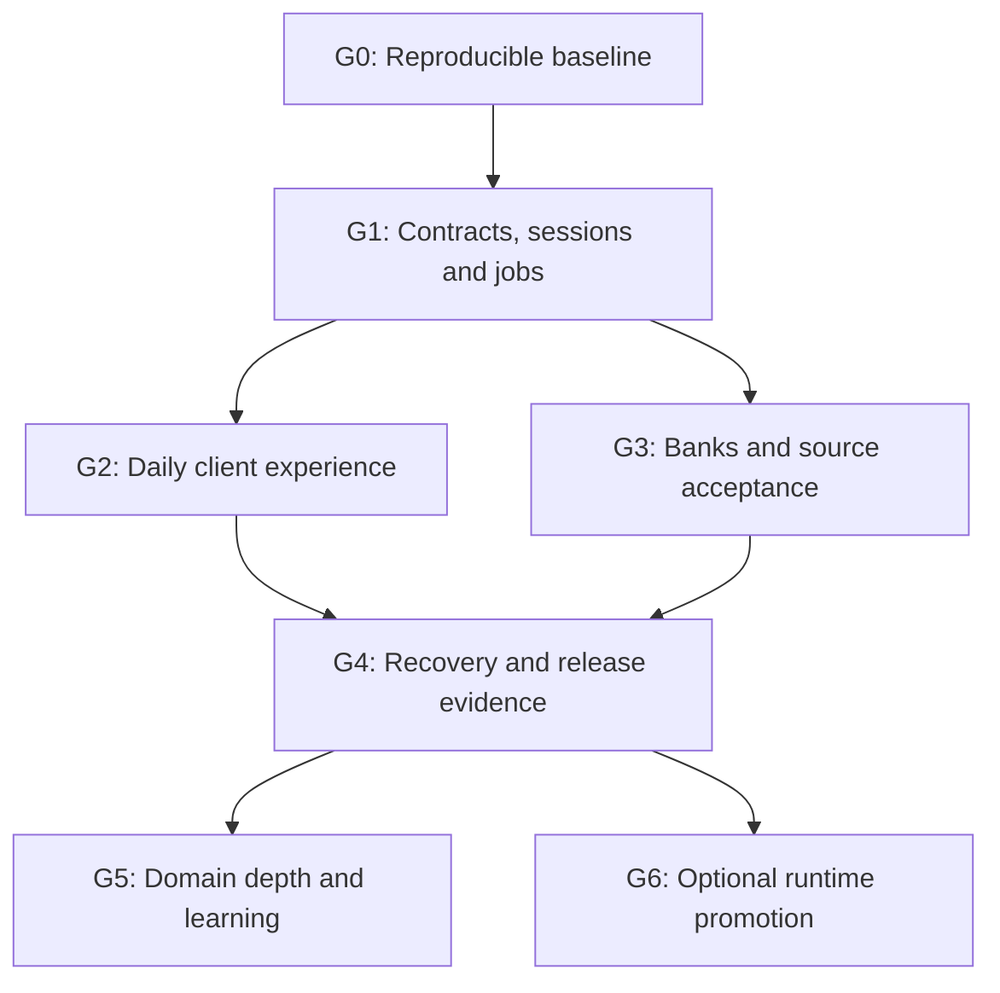

# Me+ 2.0 delivery roadmap

**Revision:** 17 October 2026 · **Task:** ME2-ARCH-007 · **Status:** proposed delivery plan; documentation only.

This is the repository's ordered planning view. [Requirements](REQUIREMENTS.md) define acceptance; [architecture](ARCHITECTURE.md) defines boundaries; the [audit](ARCHITECTURE-AUDIT-2026-10-17.md) supplies evidence and priorities. The canonical [Drive architecture](https://docs.google.com/document/d/1xFfA7FYOQSabTc3P4uD2aSlSRp-7DmIsvavrurUwDqs/edit) retains product authority. This revision supersedes earlier N26 deferral and puts **N26 + ING** in required scope. Historical V1 phase lists are context, not the execution queue.

## Outcomes

1. A small, reliable daily Me+ experience on web/tablet/computer and Android, backed by one canonical state.
2. Secure, separately controlled N26 and ING account information, plus verified Calendar and health data.
3. Useful goals, check-ins, routines, learning, workouts, nutrition and reviews delivered as small complete flows.
4. Optional AI/automation platforms that earn adoption through measured quality, cost and recovery results.

No fixed calendar date is promised before provider entitlements, runner availability and real acceptance are known. Schedule by exit gates and commit-sized tasks rather than building every domain at once.

## Current status

| Area | Evidence-backed state | Next gate |
| --- | --- | --- |
| Native database/task foundation | dev contains recovered task contracts; PR #77 prepares further backend APIs and records live deployment evidence | Consolidate dev/source/runtime provenance |
| Routine/feedback/control/MCP preparation | Present on PR #77; final preparation CI green | Owner app flow and actual scoped client/revocation acceptance |
| Google Calendar / Health Sync | Worker/control preparation; authorization deferred | Renewed consent, bounded fresh sync, then clock enable |
| N26 | Existing N26-specific implementation plus prepared cutoff/build artifacts | Shared banking contract, all-entrypoint gate, supported rollout, fresh consent and real sync |
| ING | Required by latest user direction; no adapter implementation in reviewed source | Exact country/product/provider coverage decision and institution-specific tests |
| Android health | PR #38 is pending; its batch migration absent from inspected live ledger | Dependency reconciliation, immutable artifact and real device flow |
| Letta / n8n / Langfuse | Local synthetic/isolated preparation; no persistent live adoption proven | Separate optional-runtime gates |
| Website/app | Existing Next.js Today/Now/Review and Expo health surfaces | Complete owner flows and user-visible acceptance; production deployment identity still needs verification |

## Dependency order

G2 and G3 may proceed together after their G1 dependencies. Bank consent needs the owner session/control surface. Optional agents do not gate core clients or banking. Recovery/security work starts in G0/G1 and must pass before any related live activation; it is not postponed until G4.

## G0 — consolidate the real baseline

**Priority:** P0 · **Requirement:** ME2-BASE-008 · **Responsible role:** backend/release maintainer.

- Review PR #77's exact head and reconcile it into dev through the normal workflow. This planning change does not merge it.
- Review PR #38's database dependency, artifact and final checks against current native ingestion; retain unique work rather than reimplementing it.
- Reassess PR #66 and PR #75 independently. Separate tracing from routing/model policy and retire superseded proposals only after checking unique work.
- Recover deployed gateway/reasoning/MCP/function source and runtime configuration; record active, inert, retired and unknown explicitly.
- Make the inherited starter bootstrap test create explicit incomplete/complete disposable fixtures instead of assuming Me+ product docs still contain placeholders. Preserve its negative strict-validation check. This known PR #78 CI blocker requires a separate authorized test-code change.
- Establish a reviewed Supabase schema/config baseline, migration provenance and synthetic isolated environment. Never replay historical migrations on the shared project to repair documentation.
- Record actual dev/prod hosting, app/API targets, secrets ownership and release manifests. Verify published HTTP runtime identity in a later operational check.

**Exit:** a new maintainer can reproduce the isolated schema/test baseline, identify the exact deployable source for active functions, and explain which PRs and runtime gaps remain. No unknown-source redeploy.

## G1 — complete shared contracts and trust boundaries

**Priority:** P0/P1 · **Requirements:** ME2-CONTRACT-009, ME2-SEC-010, ME2-JOBS-011.

1. Inventory the existing owner RPCs, machine Gateway, scoped MCP tools, action/routine/feedback states, errors and request IDs. Publish one versioned capability catalog; generate database types and choose reusable runtime schemas.
2. Keep user-session and machine-client authentication distinct. Implement tested SSR refresh, safe return routes, logout/recovery, owner checks, rate limits, request replay and cache isolation. Evaluate protected native credential storage without assuming it can hold every session size.
3. Move reusable Node server logic out of the web presentation tree behind a server-only module; keep Deno Edge adapters explicit. Extract mixed entrypoint concerns gradually under behavior tests.
4. Define a durable job/outbox contract using existing scheduler/dispatch capabilities first. Add connection-scoped leases, retry classification, progress/checkpoint commits, poison-job inspection and cancellation/revocation semantics. Never hold a DB transaction while waiting on a provider network call.
5. Define data lifecycle: collection purpose, source cutoff, raw/derived distinction, corrections, timezones, money precision, deletion and export. Begin core backup/restore planning now.

**Exit:** cross-owner/anonymous/forged-client denial passes; user refresh/logout works; capability DTOs match SQL; duplicate and crashed jobs resume without duplicate canonical writes; no privileged key enters a client or optional agent.

## G2 — deliver the daily product loop

**Priority:** P1 · **Requirements:** ME2-CLIENT-015, ME2-NOTIFY-017, ME2-DELIVERY-013.

Smallest complete slice:

- Sign in and recover the correct current account on web/Android; show truthful loading, empty, unavailable and stale states.
- Today/Now/Review read a bounded canonical view; explain rationale, evidence freshness and minimum action without presenting suggestions as facts.
- Create/edit/reschedule a native task; configure daily/weekly/once routines; preserve lifecycle history and conflict rules.
- Complete/partly complete/skip with stable request IDs; read back the committed state on another device.
- Record optional 1–5 helpfulness and separate follow-through through the canonical feedback operation. Retry or revise a rating safely.
- Add a small check-in and a useful evening/weekly review, not a full dashboard for every domain.
- Build connection/settings controls and limited offline cached reads/outbox. Show whether a mutation is queued, confirmed or conflicted.
- Add notification preferences/quiet hours, deduplication and expiry before enabling any push workflow. Offline banking consent and consequential external effects are not queued.

**Exit:** isolated browser/device evidence across phone, tablet and desktop; two-device readback; keyboard/a11y/error states; session refresh, expired permissions and restart/retry. Android release checks use the designated Windows runner and an immutable signed artifact.

## G3 — accept external sources, including both banks

**Priority:** P1; safety gates P0 · **Requirements:** ME2-BANK-012, ME2-HEALTH-014, ME2-CONNECT-003.

### Banking work packages

| Order | Package | Exit evidence |
| --- | --- | --- |
| B0 | Verify N26 DE and assumed ING DE retail/account products, provider entitlements, actual AIS capabilities, customer type, consent/history limits and costs | Dated capability matrix and provider decision; no assumed universal savings/card/securities access |
| B1 | Shared provider/institution/connection contract and safe migration design | N26 compatibility, institution-bound single-use callback, independent source/consent/control/clock identities |
| B2 | Harden N26 against the common contract | Durable initial sync, guarded legacy routes, cutoff, identity and retry tests; hosted rollout marker when separately authorized |
| B3 | Add ING through the same provider interface with its own fixtures | Account/balance/transaction mappings, unsupported-product behavior and provider-error/rate-limit tests |
| B4 | Later user-assisted acceptance | Separate consent per bank, fresh-only first import, reauth/revoke, replay/concurrency and independent pause/resume; then enable each clock after its own successful sync |
| B5 | Financial interpretation | Account snapshot freshness, cash-flow and recurring-obligation rules; N26↔ING transfers/refunds/currency handled without double counting or false certainty |

Detailed contracts, migration, fallback and rollout: [N26 + ING plan](plans/ME2-BANK-012-n26-ing.md). Keep both banks required even if one provider fails its eligibility gate; choose a documented alternative path instead of silently dropping ING.

### Other sources

- Calendar and Health Sync: use existing proof/start/success-before-clock gates; verify selected sources, date cutoffs, UTC versus Berlin calendar semantics and auth failure recovery.
- Health Connect: reconcile PR #38 and the missing batch migration; test pagination, revisions, deleted records, denied permissions, cursor expiry and real bounded uploads. Foreground polling must not be described as closed-app background synchronization.
- Health Sync and Health Connect overlap: declare source/metric precedence and deduplication policy so importing the same wearable fact twice does not inflate totals.
- Zepp-specific metrics: inventory actual Health Connect coverage; evaluate only official export/API paths for gaps. An export request/contact is a later explicit action.

**Exit:** source-level provenance, last successful sync, freshness and recovery are inspectable; one source can fail or be paused without corrupting another. Positive provider/device acceptance is recorded separately from source CI.

## G4 — prove operation and release

**Requirements:** ME2-OPS-016, ME2-DELIVERY-013. Related gates apply before each live capability, even while earlier groups are in progress.

- Define and rehearse backup/restore for PostgreSQL, stored objects, runtime configuration and secret references; include export and deletion across optional stores.
- **Proposed targets, subject to actual service plan and owner approval:** canonical-data RPO ≤24 hours and restore RTO ≤4 hours. These are objectives, not current guarantees. If the platform cannot meet them within budget, document an alternative before promising them.
- Establish one privacy-aware operational view: job age, last successful source sync, consent expiry, failed acknowledgements, deployment identity and AI spend. Reuse System Health & Improvements.
- Release immutable web/native/backend candidates with source SHA, artifact/bundle hash and migration/config compatibility. Keep dev → prod explicit approval. Test rollback without deleting canonical history.
- Exercise provider outage, expired consent, invalid payload, network loss, partial page commit, interrupted model call and lost optional runtime. Alert only for actionable failures; preserve a safe deterministic mode.

**Exit:** an operator can identify, diagnose, restore and roll back the actual released system with sanitized evidence. Package compilation, a ready deploy flag and metadata-only health are insufficient user acceptance.

## G5 — deepen domains and evaluate learning

**Requirements:** ME2-DOMAIN-020, ME2-EVAL-018.

Deliver one end-to-end slice at a time, reusing existing tables/contracts:

1. Goals and subjective check-ins linked to realistic daily capacity.
2. Skills/language practice, due reviews, attempts/mistakes and progression evidence with conversational continuity.
3. Workouts, exercise catalogue/progression and recovery sessions with traceable source records.
4. Meal-photo/text estimates, reusable foods/meals and quick hydration logging; retain uncertainty, portions and user corrections.
5. Finance obligations/cash-flow, weekly/monthly reviews and candidate savings actions from verified N26/ING state.
6. Other personal domains only where a real workflow is selected; keep sensitive content scoped.

Build a versioned synthetic benchmark before changing model policy. Target 100–200 scenarios across stale/missing/conflicting evidence, low capacity, finance obligations, feedback bias, duplicates and consequential advice; hold out evaluation cases. Require no critical permission/safety/schema violations and non-inferior quality before promotion. A rating or correlation does not establish causation.

## G6 — selectively adopt optional runtimes

**Requirement:** ME2-AGENT-019 · **Priority:** P2; no core delivery dependency.

- Letta: exact approved runtime/model/tool manifest, dedicated identity and directory, procedural-memory boundary, secure scoped token, real tool/revocation acceptance, encrypted off-host backup/restore and deterministic-worker fallback.
- n8n: one low-risk manual pilot; minimum credential scope, execution/log/backup retention review and reproducible workflow export. No second source of canonical facts or independent business scheduler.
- Langfuse: metadata-only source-side filtering, allowed region, retention/deletion terms, canary/deletion verification, spend/sampling limits and nonblocking exporter failure. Wire separately from model/route changes.
- Skills: source/license/hash/permissions review, synthetic prompt-injection tests and explicit admission. Do not install a skill merely because the ecosystem is available.
- Temporal or another durable engine: revisit only after real long-lived workflow complexity exceeds the existing job model and the operational/cost trade-off is measured.
- Slack: optional collaboration with links to canonical artifacts. App-level capture/notifications require a chosen scope and their own acceptance.

## Performance, cost and completion policy

Proposed initial budgets to validate in G0/G1, not observed performance claims:

- Known conversational intent: preserve one bounded bootstrap and at most two explicit fallback discovery calls (ISSUE-ENG-007).
- Common authenticated app reads: server p95 ≤1 second on representative bounded fixtures; visible Today content ≤2.5 seconds on an agreed test device/network. Measure cold and warm paths separately.
- User writes return a canonical receipt promptly; slow provider work is asynchronous with honest pending status. Establish measured acknowledgement/job-age budgets during the banking sandbox pilot.
- Bound context, pages, payload size, retry count, concurrent jobs and spend. Money uses exact decimal representation; calendar policy uses explicit zones; source freshness is domain-specific.
- Preserve the existing suggested normal incremental platform/model target ≤EUR 20/month, warning EUR 15; clarify bank-provider and backup costs before committing. Any changed recurring charge needs approval. Historical vendor prices/free tiers are not current quotations.

Only mark a requirement complete after its acceptance passes. Record code-tested, deployed, authorized, first-sync, recurring-accepted and released as distinct states. No implementation or rollout is authorized by this planning revision.
